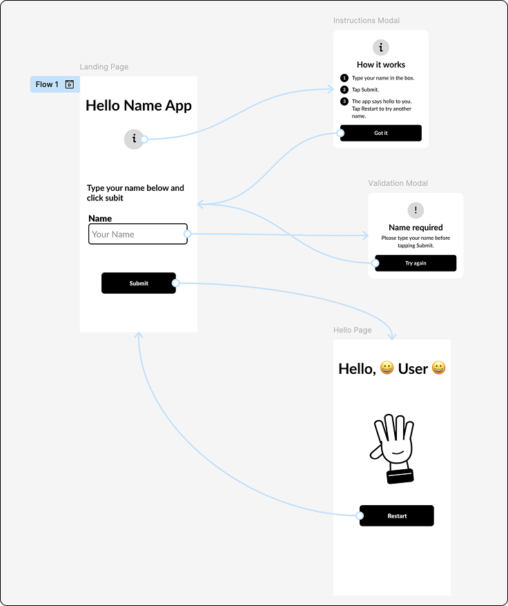

# Hello Name App

The Hello Name App is a simple, interactive web application that lets users enter their name and receive a personalised greeting. 
Table 1 below outlines its functional, non-functional and security requirements. 

| ID | Type | Requirement |
|---|---|---|
| FR01 | Functional | The landing page shall display the heading "Hello Name App", a name input field, an information icon and a Submit button. |
| FR02 | Functional | Clicking the information icon shall open a modal containing instructions on how to use the application. |
| FR03 | Functional | Clicking "Got it" shall close the instructions modal and return the user to the landing page. |
| FR04 | Functional | The name input field shall allow users to enter their name using a keyboard. |
| FR05 | Functional | Clicking Submit with an empty name field shall display a validation modal stating "Name required". |
| FR06 | Functional | Clicking "Try again" shall close the validation modal and return the user to the landing page. |
| FR07 | Functional | Submitting a valid name shall display the Hello Page with a personalised greeting containing the entered name, two smiling emojis and a waving-hand illustration. |
| FR08 | Functional | Clicking Restart shall return the user to the landing page and clear the previously entered name. |
| NFR01 | Non-functional | The application shall remain usable on screen widths from 320px to 1920px without horizontal scrolling. |
| NFR02 | Non-functional | All buttons and input fields shall be accessible using a keyboard. |
| NFR03 | Non-functional | The application shall display the greeting or validation message within one second of clicking Submit. |
| NFR04 | Non-functional | Text and interactive elements shall meet WCAG 2.2 Level AA colour contrast requirements. |
| SR01 | Security | The application shall display entered names as plain text rather than interpreting them as HTML or JavaScript. |
| SR02 | Security | The application shall not transmit entered names to external servers or store them permanently. |
| SR03 | Security | The name input field shall reject names longer than 50 characters and treat whitespace-only entries as empty. |

